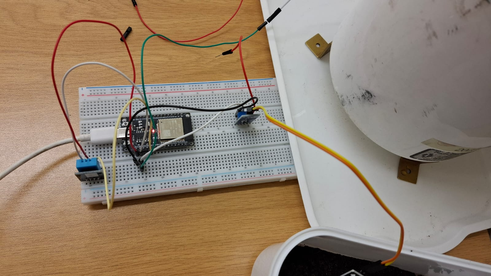

# Qaasim Isaacs

**🎯 Application Development Student | Seeking a WIL or Internship Opportunity**

[CV](#updated-cv) · [SAEON Project](#saeon-project) · [Documents](#project-documents) · [Testing](#testing-evidence)

**[Read all my reflections](#my-reflections)**

---

## 💼 Career Objective

I am a third-year Application Development student at Cape Peninsula University of Technology. I am looking for a WIL or internship opportunity where I can apply my skills, gain practical experience and continue learning.

## 💡 Skills

**Languages:** Java, Python, JavaScript and SQL.  
**Web technologies:** HTML and CSS.  
**Tools:** Git, GitHub and Figma.  
**Project experience:** Java Swing, ESP32, RFID, Firebase and MQTT.

## 🎓 Education

**CPUT | 2024–Present:** Diploma in ICT: Applications Development.

**CPUT | 2023:** Higher Certificate in Information and Communication Technology.

**Kensington High School | 2021:** National Senior Certificate.

---

## 🛠️ Projects

### Student Management System | 2025

I worked with a team to develop a Java Swing application for managing student records. We used object-oriented programming, an SQL database and input validation to organise and manage the information.

[View the project](https://github.com/MQaasimI/Student-Enrolment-Project.git)

### NSFAS App Redesign | 2025

I helped redesign the NSFAS mobile app in Figma. Our team reviewed usability problems and created low- and high-fidelity prototypes to improve the layout, navigation and accessibility.

[View the prototype](https://www.figma.com/proto/2o459QPq1FgqfB1zrhvukq/Untitled?node-id=0-1&t=zIwd0aX64qaMLr3K-1)

### Smart Attendance System | 2026

This project uses an ESP32 and RFID to record student attendance in Firebase. It aims to reduce manual recording and make attendance information easier to manage.

[View the project](https://github.com/MQaasimI/Smart-Attendance-System.git)

---

## 📇 References

**Jason Sankar**  
083-475-4871 · [Jason@rdinformatics.co.za](mailto:Jason@rdinformatics.co.za)

**Waldon Hendricks**  
073-469-6742 · [hendricksw@cput.co.za](mailto:hendricksw@cput.co.za)

## 📬 Contact

[064-845-4933](tel:+27648454933) · [qisaacs001@gmail.com](mailto:qisaacs001@gmail.com)  
Kensington, Cape Town  
[LinkedIn: Qaasim Isaacs](https://www.linkedin.com/in/qaasim-isaacs)

---

## 🎥 Mock Interview

My WIL preparation interview covers my interests, handling stress, learning from a mistake and what success means to me.

<video width="350" controls playsinline preload="metadata" style="max-width:100%;height:auto;">
  <source src="Media/Mock%20interview%20of%20Qaasim%20Isaacs%20%282%29.mp4" type="video/mp4">
  Your browser does not support video playback.
</video>

[Watch or download my mock interview](Mock%20interview%20of%20Qaasim%20Isaacs%20%282%29.mp4)

---

## CV

My CV includes my education, skills, projects, contact details and references.

[View CV Of Qaasim Isaacs.pdf](Documents/CV%20Of%20Qaasim%20Isaacs.pdf)

---

## SAEON Project

**Real-Time Rainfall Monitoring System | 2026**  
**My role:** Backend Developer and Tester  
**Reporting period:** 28 July – 23 October 2026

### About the Project

Our team worked on a prototype for viewing rainfall, temperature and humidity readings remotely. The planned route is ESP32, SIM7000G cellular communication, HiveMQ Cloud MQTT, a backend service, Firebase and a dashboard. The dashboard requirements include current readings, history, CSV exports and station-health information.

The system uses a TR-525M rain gauge. DHT11 is used for testing, while SHT31 is selected for the final temperature and humidity sensor. Final SHT31 validation and Firebase ingestion and access checks remain follow-up work.

### My Contribution

The sprint backlog records my work on development setup, MQTT broker configuration, topic permissions, publishing tests and Firebase integration. My assigned work also includes network stability, cloud-command preparation, CSV exports, integration tests and power checks. These tasks are reported as completed, with supporting evidence still requiring review.

I am also responsible for starting and monitoring the field stress test. This work remains in progress, alongside installation and calibration. My next steps include Firebase checks with Angelo and supporting Redah with final SHT31 verification.

---

## Project Documents

Each PDF below explains part of our work. All reflections are grouped at the end of this page.

### Agile Team Charter

The charter explains our purpose, roles, communication arrangements and definition of done. It shows how we divided responsibilities and agreed to work together.

[View SAEON_Agile_Team_Charter.pdf](Documents/SAEON_Agile_Team_Charter.pdf) · [Read my reflection](#agile-team-charter-reflection)

### User Stories and Tasks

This document breaks user needs into tasks and acceptance criteria. It covers sensor readings, communication, storage, dashboard features, access and deployment.

[View SAEON_User_Stories_and_Tasks.pdf](Documents/SAEON_User_Stories_and_Tasks.pdf) · [Read my reflection](#user-stories-and-tasks-reflection)

### Product Backlog

The product backlog lists priorities, responsibilities and progress. It includes outstanding field work and follow-ups for SHT31, Firebase and portfolio evidence.

[View SAEON_Product_Backlog.pdf](Documents/SAEON_Product_Backlog.pdf) · [Read my reflection](#product-backlog-reflection)

### Sprint Backlog

The sprint backlog divides the project into 13 weekly periods with goals, assigned tasks and acceptance requirements. Its proposed effort estimates support planning; they are not actual hours worked.

[View SAEON_Sprint_Backlog.pdf](Documents/SAEON_Sprint_Backlog.pdf) · [Read my reflection](#sprint-backlog-reflection)

### Agile Logbook

My logbook records activities, next steps and risks against the Tuesday-to-Friday schedule. Its entries are reconstructed and need my confirmation against actual work and evidence.

[View SAEON_Agile_Logbook_Qaasim.pdf](Documents/SAEON_Agile_Logbook_Qaasim.pdf) · [Read my reflection](#agile-logbook-reflection)

### Project Report and Register

This September report covers WIL activities, attendance entries, NFC proposal work and mentor feedback. It also records the Woolworths Women in Tech Expo, where Redah, Ethan and I demonstrated our projects.

[View Project Report and register.pdf](Documents/Project%20Report%20and%20register.pdf)

### Graduate Attributes and Portfolio Evidence

This document connects the project to Ubuntu, technological capability and foresight, resilience and problem solving, and ethical capability and respect. It identifies supporting evidence and areas requiring confirmation.

[View SAEON_Graduate_Attributes_and_Portfolio_Evidence.pdf](Documents/SAEON_Graduate_Attributes_and_Portfolio_Evidence.pdf)

---

## Testing Evidence

### Prototype Photograph

This team photograph shows the ESP32 breadboard setup, DHT11 test sensor and rain-gauge equipment. It documents the prototype setup; final SHT31 validation is separate.

[Open Testing_Evidence_2.jpeg](Media/Testing_Evidence_2.jpeg)

### Testing Video

<video width="360" controls playsinline preload="metadata" style="max-width:100%;height:auto;">
  <source src="Media/Testing_Evidence.mp4" type="video/mp4">
  Please use the video link below if the player is unavailable.
</video>

[Watch or download Testing_Evidence.mp4](Media/Testing_Evidence.mp4)

The video shows prototype equipment and serial-monitor readings for rain tips, rainfall and exploratory soil moisture. It provides local bench-test evidence. Soil moisture is outside the documented final scope, and the clip does not verify cloud delivery, calibration or the 48-hour field test. Capture dates and individual operators are not recorded for these media files.

---

## My Reflections

### CV in Markdown

Creating my CV in Markdown was new to me. I used headings, links and sections to make my information easier to read. My profile image did not display correctly at first, so I checked its filename and path and used HTML to resize it. This helped me become more confident with Markdown and taught me to check the finished page carefully.

### Mock Interview Experience

I prepared answers about my interests, stress, mistakes and success, using my own experiences. I used the STAR method to organise the behavioural answer and recorded with a friend in a quiet space. Being on camera felt awkward at first, but preparation helped me speak more naturally. I learned to organise my thoughts and want to keep practising without rushing.

### Using GitHub Pages

I followed our lecturer's guide to set up my repository and publish my portfolio. I was unfamiliar with GitHub Pages, so I tried different formatting and checked the results as I worked. This made me more comfortable learning new tools. I also learned that filenames and links need to match so other people can open my work.

### My SAEON Contribution

My backend and testing role helped me understand how sensor readings move through several parts of a system. The messaging, database and dashboard need to work together. I learned why each stage needs clear checks and why timestamps and units matter. I want to improve how I save test results and code references so my contribution is easier to explain.

### Agile Team Charter Reflection

The charter helped me understand my responsibilities and how my work depends on the hardware and frontend members. Clear roles and communication arrangements make teamwork easier. I also learned that completing a task includes reviewing its evidence. Next time, I would revisit the charter when responsibilities change so everyone stays clear about their role.

### User Stories and Tasks Reflection

The user stories helped me think about what researchers need from the system. A stored reading needs a station, time and unit to be useful. Breaking each story into tasks made the work easier to follow, while acceptance criteria showed what to check. I want to link test results directly to their stories to make progress clearer.

### Product Backlog Reflection

The product backlog helped me see how the different parts of the project fit together. It showed why important work, such as Firebase checks and field testing, needs attention before optional features. I learned that priorities and statuses need regular review. I would improve this by keeping evidence links and remaining tasks updated as the work progresses.

### Sprint Backlog Reflection

The sprint backlog made the project more manageable by dividing it into weekly goals. It helped me understand my MQTT, Firebase and testing responsibilities. I also learned that effort estimates are different from actual hours worked. For future sprints, I want to record results and review notes as we go so the next plan reflects what happened.

### Agile Logbook Reflection

The logbook helps me separate my own contribution from the team's work. Its questions give me a way to record progress, next steps and problems. The current entries are reconstructed, so I need to confirm and correct them using my actual records. Keeping short daily notes with task references would make this easier and more accurate in future.

### Testing Evidence Reflection

The photograph and video make the prototype easier to understand. They also remind me to explain exactly what a test shows. Serial readings alone do not confirm accuracy or outdoor performance. For future tests, I want to record the date, sensor, expected result and observed result so the evidence is easier to follow.

### Project Report and WIL Reflection

The report connects our technical work with proposal writing, mentor involvement and the expo demonstration. It shows me that explaining a project is also part of the work. I want to keep improving how I present technical ideas clearly and keep activity records consistent so they support what I say about my contribution.

### Graduate Attributes Reflection

**Ubuntu:** My work depends on cooperation with the team. I want to keep improving how I share information, ask for help and consider the people who will use the system.

**Knowing Technological Capability and Foresight:** The project connects programming, electronics and data storage. It helped me think about maintenance, power and reliable readings when considering how the system could be used over time.

**Resilience and Problem Solving Capability:** Testing requires a step-by-step approach. I want to record what I find at each stage so that problems are easier to investigate and the team can build on earlier results.

**Ethical Capability and Respect:** I need to give teammates credit, protect personal information and describe my contribution honestly. This includes identifying the sensor used and keeping unfinished tests marked as unfinished.
